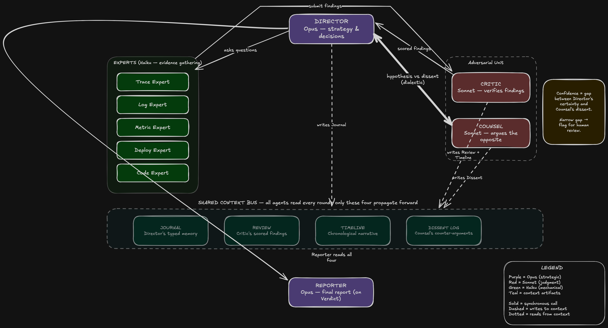

# Argus

Argus is a multi-agent incident investigation system. It receives a production incident, gathers evidence from observability systems, verifies findings, challenges the leading hypothesis, and writes a final report with citations and confidence.



The core product is citation-backed incident reasoning:

```text
Director -> Experts -> Critic -> Counsel -> Reporter
```

## Status

The foundation phases and the v1 launch path are implemented. See [docs/project/delivery-plan.md](docs/project/delivery-plan.md) and [docs/product/limitations-and-roadmap.md](docs/product/limitations-and-roadmap.md) for what is left.

Documentation lives in [docs/](docs/README.md). Start with:

- [Architecture overview](docs/architecture/overview.md)
- [Engineering standards](docs/architecture/engineering-standards.md)
- [Delivery plan and phase status](docs/project/delivery-plan.md)
- [plan.md](plan.md) and [AGENTS.md](AGENTS.md)

## Fixed Stack

- TypeScript
- Node 22 for production services
- Fastify for the API server
- Inngest for durable workflows
- Postgres 16 with Drizzle ORM
- Zod for validation
- Anthropic SDK behind model aliases
- Pino for logging
- OpenTelemetry for tracing
- Next.js App Router for Dashboard
- SSE for realtime updates

## Architecture

```text
Incident source
  -> API server
  -> Inngest workflow
  -> Worker agents/tools
  -> Postgres artifacts/events
  -> Dashboard via API REST + SSE
```

The API server owns HTTP and reads. Worker owns agents, tools, workflows, and writes. Dashboard talks only to the API server.

## First Build Target

The first useful vertical slice is:

```text
POST /investigations
-> Inngest workflow
-> Director
-> one mocked Expert
-> Critic
-> Reporter
-> persisted report with citations
```

Do not start with dashboard polish or replay branching.

## Environment

Create a local env file from the example:

```bash
cp .env.example .env
```

Real secrets must never be committed.

## Build Order

Follow [docs/project/delivery-plan.md](docs/project/delivery-plan.md). Each phase should produce a working vertical slice before adding optional features.

## Local Demo and Evaluation

Run the reproducible local demo with [docs/guides/quickstart.md](docs/guides/quickstart.md).

Evaluation commands:

```bash
pnpm eval:smoke
pnpm eval:full path/to/full-dataset.json
```

## v1 Release Path

The foundation phases are complete. The live v1 path is tracked in:

- [docs/product/limitations-and-roadmap.md](docs/product/limitations-and-roadmap.md)
- [docs/guides/configuration.md](docs/guides/configuration.md)
- [docs/guides/api.md](docs/guides/api.md)
- [docs/operations/security.md](docs/operations/security.md)
- [docs/operations/deployment.md](docs/operations/deployment.md)
- [docs/project/delivery-plan.md](docs/project/delivery-plan.md)

## Database

Drizzle migrations are generated from [packages/db/src/schema.ts](packages/db/src/schema.ts).

```bash
pnpm db:up
pnpm db:generate
pnpm db:migrate
```

`db:migrate` requires `DATABASE_URL` to point at a running Postgres database.

## Agentic Coding Commands

Use short commands instead of rewriting the plan each time:

```text
next phase 0
review phase 0
fix phase 0
status
```

See [docs/project/delivery-plan.md](docs/project/delivery-plan.md). Agents should update its phase table after phase work.

## Author

Maintained by PranavTJ-05. Licensed under the [MIT License](LICENSE).
